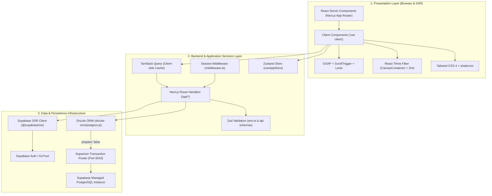

# NASA Space Apps — System Architecture

---

## Layer 1: Presentation Layer

- **Framework**: Next.js 15 App Router running React 19.
- **Rendering Strategy**: Server Components by default for zero client JavaScript overhead; selective Client Components (`'use client'`) for interactive controls, state subscriptions, and WebGL rendering.
- **Styling**: Tailwind CSS 4 utilizing CSS-first `@theme inline` variables with OKLCH color spaces.
- **Cinematic Engine**: GSAP timelines synchronized with Lenis smooth scrolling and ScrollTrigger pinning/scrubbing.
- **3D Graphics**: Three.js and `@react-three/fiber@^9.0` with lazy-loaded dynamic imports (`ssr: false`) to safeguard server rendering.

## Layer 2: Application Services Layer

- **API Routing**: Next.js Route Handlers (`src/app/api/`) providing RESTful endpoints.
- **Session Middleware**: Edge/Node middleware (`middleware.ts`) proxying cookies and updating Supabase authentication sessions seamlessly.
- **Server State Management**: `@tanstack/react-query` managing caching, deduplication, and stale-while-revalidate lifecycle.
- **Client State Management**: `zustand` managing lightweight UI controls (audio mute, graphics fidelity, active sections).
- **Validation**: `zod` validating environment variables, API payloads, and query parameters at boundaries.

## Layer 3: Data Infrastructure Layer

- **Authentication**: Supabase Auth handling user sign-up, sign-in, token refresh, and Row Level Security context.
- **Relational Storage**: PostgreSQL hosted on Supabase.
- **ORM & Migrations**: Drizzle ORM (`drizzle-orm` + `drizzle-kit`).
- **Connection Strategy**:
  - _Runtime Queries_: postgres-js connecting to Supavisor Transaction Pooler on port 6543 with `{ prepare: false }`.
  - _Schema Migrations_: Direct / Session connection on port 5432 (`DIRECT_URL`).
  - _Server Isolation_: Database modules protected with `import 'server-only'`.
