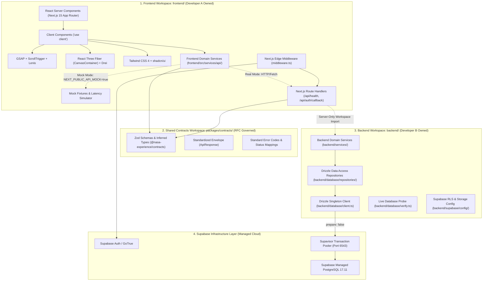

# NASA Space Apps — System Architecture (Physical Separation)

---

## 1. Physical Workspace Structure

1. **`frontend/`** (Developer A):
   - Standalone Next.js 15 application.
   - Runs on port 3000 (`pnpm dev`).
   - Completely functional with offline mock data (`NEXT_PUBLIC_API_MOCK=true`).
2. **`backend/`** (Developer B):
   - Supabase database schemas, Drizzle migrations, and backend services.
   - Verified live database probe (`pnpm db:verify`).
   - No Express or custom HTTP server required; Supabase handles backend infrastructure.
3. **`packages/contracts/`** (Shared):
   - Published as workspace package `@nasa-experience/contracts`.
   - Zod schemas and TypeScript types consumed by both `frontend/` and `backend/`.

---

## 2. Environment Variables & Credentials

- Root `.env` and `.env.local` are preserved byte-for-byte at the root.
- `frontend/next.config.ts` and `backend/config/env.ts` safely load root environment files via `dotenv` with `.env.local` taking precedence.
- Sensitive credentials (`DATABASE_URL`, `SUPABASE_SERVICE_ROLE_KEY`) are never exposed to browser bundles.
