# Parallel Development Workflow & 3-Prompt Strategy

This document describes the day-to-day workflow for two developers working concurrently on the physically separated NASA Space Apps platform.

---

## 1. Physical Workspaces

- **Frontend Developer (Developer A)**: Works inside `frontend/`.
- **Backend Developer (Developer B)**: Works inside `backend/`.
- **Shared Coordination**: Works on `packages/contracts/` via approved RFCs.

---

## 2. The 3-Prompt Planning Cadence

Work is structured into small, verifiable 3-prompt increments:

```mermaid
gantt
    title Parallel Development Cycle Cadence
    dateFormat  X
    axisFormat %s
    section Frontend (Developer A)
    Prompt 1 (Shell & Mock Service)  :active, f1, 0, 1
    Prompt 2 (Components & State)    :active, f2, 1, 2
    Prompt 3 (Motion & UI Tests)     :active, f3, 2, 3
    section Backend (Developer B)
    Prompt 1 (DB Schema & Migr)      :active, b1, 0, 1
    Prompt 2 (Repositories & Unit)   :active, b2, 1, 2
    Prompt 3 (Services & DB Probes)  :active, b3, 2, 3
    section Synchronization
    Integration Phase (Merge & E2E)  :crit, sync, 3, 4
```

### Frontend Developer Workflow (`frontend/`)

- **Prompt 1**: Consume contract from `@nasa-experience/contracts`, scaffold mock data in `frontend/src/services/api/mocks/`, scaffold page layout.
- **Prompt 2**: Implement UI components, TanStack Query hooks, Zustand store updates, loading skeletons, and error boundaries.
- **Prompt 3**: Implement GSAP timelines, 3D WebGL scenes, and write Vitest component tests (`pnpm test:frontend`).

### Backend Developer Workflow (`backend/`)

- **Prompt 1**: Define Drizzle tables in `backend/database/schema/`, generate migrations (`pnpm db:generate`), verify database connection (`pnpm db:verify`).
- **Prompt 2**: Implement database repositories in `backend/database/repositories/` and write query tests.
- **Prompt 3**: Implement backend domain services in `backend/services/` and verify with `pnpm test:backend`.

---

## 3. Pull Request Guidelines

Before opening a PR:

1. Feature branch names: `frontend/<feature>` or `backend/<feature>`.
2. Confirm zero cross-boundary modifications (`git diff origin/main`).
3. Run `pnpm boundary:check`, `pnpm type-check`, and `pnpm test:all`.
