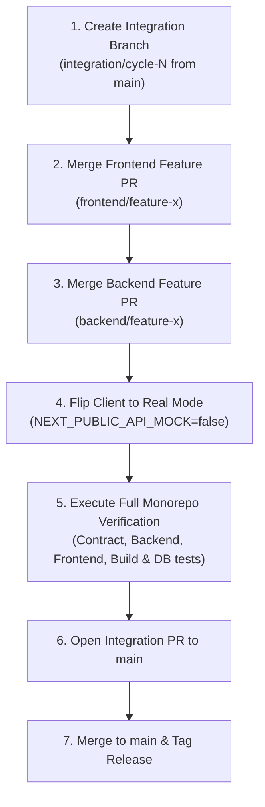

# Integration Workflow & Synchronization Runbook

Integration is an explicit, scheduled development phase where independent frontend and backend feature work is merged, connected, and verified.

---

## 1. When Does Integration Occur?

Integration happens only after both developers have completed their planned features for a cycle on their respective feature branches (`frontend/<name>` and `backend/<name>`) and all independent quality gates have passed.

---

## 2. Integration Step-by-Step Procedure



### Integration Commands

```bash
# 1. Run all tests across workspace
pnpm test:all

# 2. Verify architectural boundaries
pnpm boundary:check

# 3. Verify strict TypeScript type checking across all workspaces
pnpm type-check

# 4. Verify Next.js production build
pnpm build

# 5. Verify live PostgreSQL connectivity
pnpm db:verify
```
