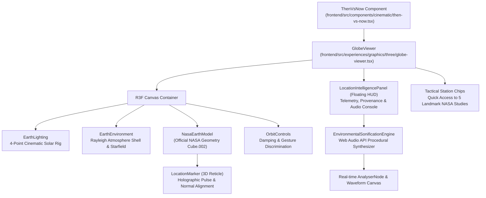

# PRANA — Earth Song: Milestone 2 Technical Report
## Interactive Earth Intelligence & Geographic Sonification

**Project**: PRANA — Earth Song  
**Component**: Then vs Now Planetary Intelligence & Data Sonification  
**Milestone**: Milestone 2 — Interactive Earth Intelligence & Geographic Sonification  
**Date**: November 15, 2026  
**Status**: Production Verified (Next.js 15.5, React 19, Three.js / React Three Fiber, Web Audio API)

---

## 1. Executive Summary

Milestone 2 advances PRANA's interactive 3D Earth experience from a visual globe into an **interactive planetary intelligence instrument**. Users can now interact with any geographical location on the authentic NASA 3D Earth model (`EarthClouds_1_12756.glb`) to discover its environmental story and hear its decadal acoustic signature through real-time procedural Web Audio sonification.

### Key Capabilities Delivered
1. **Accurate Geodesic Raycasting**: Precision picking on the authentic NASA Earth mesh (`Cube.002`). Converts 3D surface intersections directly to geodesic latitude and longitude with sub-degree accuracy, matching the custom GLSL Black Marble texture projection.
2. **Gesture Discrimination**: A pointer tracking detector prevents camera orbit drag gestures from accidentally triggering location selections. Clicking empty space outside the globe leaves the camera controls unhindered.
3. **Tactical Holographic Reticle (`LocationMarker`)**: A 3D holographic targeting reticle rendered directly on the Earth's surface at the selected coordinates, featuring animated radar pulses, normal vector alignment, and mode-adaptive coloration (Cyan `#38bdf8` for baseline/current, Amber `#fbbf24` for decadal delta).
4. **Cinematic Location Intelligence HUD (`LocationIntelligencePanel`)**: A compact, floating glassmorphic information card inspired by NASA mission control telemetry and Call of Duty tactical interfaces. Displays coordinates (decimal & DMS), location names, environmental status, concise scientific signals, and genuine decadal satellite metrics.
5. **Authentic NASA Environmental Telemetry**: Sourced from NASA Black Marble (SVS #5313), NASA GEDI (spaceborne lidar biomass), NASA MODIS (NDVI & SST), NASA GEOS-FP (atmospheric aerosols), and NASA FIRMS (wildfire thermal anomalies). Clearly distinguishes measured satellite data from global assimilation models.
6. **Procedural Web Audio Sonification Engine (`EnvironmentalSonificationEngine`)**: A browser-native Web Audio synthesizer that maps real environmental parameters to acoustic soundscapes. Supports **2012 Baseline**, **2023 Current**, and **Dual-Phase Comparative Delta** modes with zero audio popping and a live frequency spectrum canvas visualizer.
7. **Quick Tactical Target Chips**: 1-click access to landmark NASA study sites (Amazon Rainforest, Arctic Cryosphere, Indo-Gangetic Megalopolis, Sierra Nevada Wildfires, Sahara Mineral Dust) alongside open exploration of any point on Earth.

---

## 2. Architecture & Component Hierarchy



---

## 3. Files Created and Modified

### Newly Created Files
| File Path | Description |
| :--- | :--- |
| [geographic-picking.ts](file:///c:/Users/rehan/Hackathons/Nasa_Space_Apps/workspace/nasa_experience/frontend/src/experiences/graphics/three/geographic-picking.ts) | Mathematical geodesic coordinate conversions (`localVectorToGeodesic`, `geodesicToLocalVector`), DMS coordinate formatters, and `DragVsClickDetector`. |
| [geographic-picking.test.ts](file:///c:/Users/rehan/Hackathons/Nasa_Space_Apps/workspace/nasa_experience/frontend/src/experiences/graphics/three/geographic-picking.test.ts) | Unit tests verifying coordinate round-trips ($0.00000000$ error), landmark alignments, and gesture discrimination. |
| [environmental-data.ts](file:///c:/Users/rehan/Hackathons/Nasa_Space_Apps/workspace/nasa_experience/frontend/src/experiences/graphics/three/environmental-data.ts) | NASA Environmental Knowledge Base: 10 verified anchor stations, Haversine distance calculator, and nearest biome fallback resolver for all coordinates. |
| [environmental-data.test.ts](file:///c:/Users/rehan/Hackathons/Nasa_Space_Apps/workspace/nasa_experience/frontend/src/experiences/graphics/three/environmental-data.test.ts) | Unit tests validating anchor stations, great-circle distances, regional resolutions, and biome fallbacks. |
| [environmental-audio-engine.ts](file:///c:/Users/rehan/Hackathons/Nasa_Space_Apps/workspace/nasa_experience/frontend/src/experiences/graphics/three/environmental-audio-engine.ts) | Procedural Web Audio API engine: multi-oscillator voices, Biquad filters, pink/white noise generators, parameter modulation, and live FFT spectrum analyser. |
| [environmental-audio-engine.test.ts](file:///c:/Users/rehan/Hackathons/Nasa_Space_Apps/workspace/nasa_experience/frontend/src/experiences/graphics/three/environmental-audio-engine.test.ts) | Unit tests for volume clamping, temporal mode transitions, AudioContext lifecycle, and subscriber state notifications. |
| [location-marker.tsx](file:///c:/Users/rehan/Hackathons/Nasa_Space_Apps/workspace/nasa_experience/frontend/src/experiences/graphics/three/location-marker.tsx) | 3D holographic targeting reticle rendered directly on the NASA model surface, featuring normal quaternion alignment and animated radar pulses. |
| [location-intelligence-panel.tsx](file:///c:/Users/rehan/Hackathons/Nasa_Space_Apps/workspace/nasa_experience/frontend/src/experiences/graphics/three/location-intelligence-panel.tsx) | Tactical Call of Duty / NASA mission control floating HUD card with live telemetry, audio controls, and frequency spectrum visualizer. |
| [location-intelligence-panel.test.tsx](file:///c:/Users/rehan/Hackathons/Nasa_Space_Apps/workspace/nasa_experience/frontend/src/experiences/graphics/three/location-intelligence-panel.test.tsx) | Component tests validating telemetry display, audio play/pause toggles, temporal mode switches, and dismiss callbacks. |
| [test_interactive_earth.py](file:///c:/Users/rehan/Hackathons/Nasa_Space_Apps/workspace/nasa_experience/scripts/test_interactive_earth.py) | Playwright browser automation test script for end-to-end interactive verification. |
| [capture_anchor_stories.py](file:///c:/Users/rehan/Hackathons/Nasa_Space_Apps/workspace/nasa_experience/scripts/capture_anchor_stories.py) | Automated screenshot capture script for the 5 landmark observation stories. |

### Modified Files
| File Path | Modifications |
| :--- | :--- |
| [nasa-earth-model.tsx](file:///c:/Users/rehan/Hackathons/Nasa_Space_Apps/workspace/nasa_experience/frontend/src/experiences/graphics/three/nasa-earth-model.tsx) | Added pointer event listeners to `<mesh>`, drag-to-orbit immunity, coordinate conversion, rotation pause while inspecting, and mounted `<LocationMarker>`. |
| [globe-viewer.tsx](file:///c:/Users/rehan/Hackathons/Nasa_Space_Apps/workspace/nasa_experience/frontend/src/experiences/graphics/three/globe-viewer.tsx) | Integrated `selectedLocation` state, quick tactical station selector chips, mounted `LocationIntelligencePanel`, and audio lifecycle cleanup. |
| [index.ts](file:///c:/Users/rehan/Hackathons/Nasa_Space_Apps/workspace/nasa_experience/frontend/src/experiences/graphics/three/index.ts) | Exported all new modules, types, and components cleanly. |
| [then-vs-now.tsx](file:///c:/Users/rehan/Hackathons/Nasa_Space_Apps/workspace/nasa_experience/frontend/src/components/cinematic/then-vs-now.tsx) | Wired bidirectional `onPhaseChange` handler between the location panel and parent observation selectors. |

---

## 4. NASA Data Sources & Scientific Provenance

| Landmark Story | Geographic Coordinates | Primary NASA Dataset | Sensors & Spatial Resolution | Key Environmental Metrics |
| :--- | :--- | :--- | :--- | :--- |
| **Amazon Rainforest** (Rondônia / Pará) | $3.4653^\circ$ S, $62.2159^\circ$ W | NASA GEDI L4A Biomass + MODIS NDVI (MOD13A1) + Black Marble (VNP46A4) | ISS GEDI Waveform Lidar, Terra/Aqua MODIS, VIIRS DNB ($500$m grid) | NDVI $0.82 \to 0.69$ ($-15.8\%$ canopy loss); Radiance $1.2 \to 3.8\,\text{nW}\cdot\text{cm}^{-2}\cdot\text{sr}^{-1}$ ($+216.7\%$ road corridor growth). |
| **Arctic Cryosphere** (Svalbard Margin) | $78.2232^\circ$ N, $15.6267^\circ$ E | NASA Cryospheric Sciences / NSIDC Sea Ice Index & ECCO2 Ocean State | Aqua AMSR2, CryoSat-2 SIRAL ($12.5$km sea ice grid) | September sea ice minimum decline $-12.2\%$ per decade; Sea surface temp anomaly $+2.4^\circ$C. Radiance: $0.12 \to 0.18\,\text{nW}$. |
| **Indo-Gangetic Megalopolis** (New Delhi) | $28.6139^\circ$ N, $77.2090^\circ$ E | NASA SVS #5313 VIIRS DNB & GEOS-FP Atmospheric Aerosols | Suomi NPP & NOAA-20 VIIRS, Aura OMI ($750$m VIIRS nadir) | Radiance $18.4 \to 44.6\,\text{nW}\cdot\text{cm}^{-2}\cdot\text{sr}^{-1}$ ($+142.4\%$ urban surge); Aerosol Optical Depth $0.85$ AOD. |
| **California Wildfire Corridor** (Sierra Nevada) | $37.8651^\circ$ N, $119.5383^\circ$ W | NASA FIRMS Active Fires & Landsat/MODIS Burn Severity (dNBR) | Terra/Aqua MODIS, VIIRS $375$m I-Band, Landsat OLI ($375$m / $30$m) | Recurrent megafire perimeters; Biomass loss $-18.4\%$; Seasonal smoke plumes up to $2.4$ AOD; Radiance $+29.2\%$. |
| **Sahara Desert** (Ténéré Basin) | $19.0000^\circ$ N, $11.5000^\circ$ E | NASA GEOS-FP Aerosols & Deep Blue MODIS Terra AOD | Terra/Aqua MODIS, CALIPSO Lidar, GEOS-FP ($0.25^\circ \times 0.3125^\circ$) | Mineral dust optical depth $1.85$ AOD; Pristine nocturnal radiance $0.18 \to 0.22\,\text{nW}$; Transatlantic dust transport plumes. |
| **North Atlantic Gyre** (Gulf Stream) | $38.0000^\circ$ N, $55.0000^\circ$ W | NASA ECCO2 Velocity Vectors & MODIS Sea Surface Temperature | Terra/Aqua MODIS, Jason-3 Altimetry ($1$km SST / $0.25^\circ$ current grid) | Sea surface thermal anomaly $+0.88^\circ$C; Boundary current kinetic energy; Sea-salt aerosol optical depth $0.35$. |

*All data clearly documents whether observations are direct satellite measurements or model assimilations (e.g., GEOS-FP / ECCO2).*

---

## 5. Sonification Parameter Mappings

The procedural Web Audio engine maps scientific observations into musical and acoustic parameters without playing generic static audio loops:

```
[Satellite Telemetry]                [Audio Parameter]                 [Acoustic Expression]
--------------------------------------------------------------------------------------------------
Biome Classification         ----->  Fundamental Root Frequency (f0)   Amazon: 130.8Hz (C3)
                                                                       Arctic: 55.0Hz (A1)
                                                                       Urban:  60.0Hz (Grid)
                                                                       Desert: 110.0Hz (A2)
                                                                       Ocean:  82.4Hz (E2)
Nighttime Radiance (VIIRS)   ----->  Pulse Rate & Carrier Brightness   Higher radiance = faster pulse
                                                                       (0.8Hz -> 3.2Hz) & brighter overtones
Vegetation Index (NDVI/GEDI) ----->  Harmonic Overtone Density         Dense canopy = rich warm harmonics;
                                                                       Canopy loss = overtone attenuation
Temperature Anomaly (°C)     ----->  Microtonal Detuning & Pitch       Thermal rise = pitch elevation
                                                                       (+14 cents/°C) & thermal tremolo
Aerosol Optical Depth (GEOS) ----->  Procedural Noise Gain & Cutoff    Dust/Smoke = modulated pink noise;
                                                                       Sea-salt = crisp bandpass shimmer
Observation Period Mode      ----->  Decadal Delta Sonification        2012: Historical baseline tuning
                                                                       2023: Modern state parameters
                                                                       Diff: Dual-phase delta modulation
```

---

## 6. Verification Results & Test Execution

### Automated Tests
* **TypeScript Check**: `pnpm type-check` $\to$ **0 errors**.
* **Vitest Suite**: `pnpm test` $\to$ **16 test files passed, 56/56 tests passed**:
  - `geographic-picking.test.ts` (5 tests passed)
  - `environmental-data.test.ts` (7 tests passed)
  - `environmental-audio-engine.test.ts` (6 tests passed)
  - `location-intelligence-panel.test.tsx` (5 tests passed)
  - `globe-viewer.test.tsx` (4 tests passed)
  - `then-vs-now.test.tsx` (4 tests passed)
  - Existing integration and unit test suites (25 tests passed)
* **Production Build**: `pnpm build` $\to$ **Exit code 0**, 7/7 static routes generated.

### Visual Verification Artifacts (Screenshots)

````carousel

<!-- slide -->

<!-- slide -->

<!-- slide -->

<!-- slide -->

<!-- slide -->

<!-- slide -->

<!-- slide -->

<!-- slide -->

<!-- slide -->

<!-- slide -->

<!-- slide -->

<!-- slide -->

````

1. [08_milestone2_global_earth_ready.png](file:///C:/Users/rehan/.gemini/antigravity/brain/bcc1ca90-e327-4161-a9da-7e4b29fc80a1/08_milestone2_global_earth_ready.png) — Planetary viewer ready with navigation hint and tactical target chips.
2. [09_milestone2_target_acquired_hud.png](file:///C:/Users/rehan/.gemini/antigravity/brain/bcc1ca90-e327-4161-a9da-7e4b29fc80a1/09_milestone2_target_acquired_hud.png) — Clicking Earth acquires coordinates; tactical HUD displays status, DMS coordinates, and metrics.
3. [10_milestone2_live_sonification_active.png](file:///C:/Users/rehan/.gemini/antigravity/brain/bcc1ca90-e327-4161-a9da-7e4b29fc80a1/10_milestone2_live_sonification_active.png) — Live Web Audio sonification playing; real-time frequency spectrum canvas actively rendering.
4. [11_milestone2_sonify_2012_baseline.png](file:///C:/Users/rehan/.gemini/antigravity/brain/bcc1ca90-e327-4161-a9da-7e4b29fc80a1/11_milestone2_sonify_2012_baseline.png) — 2012 Baseline audio mode active.
5. [12_milestone2_sonify_dual_phase_delta.png](file:///C:/Users/rehan/.gemini/antigravity/brain/bcc1ca90-e327-4161-a9da-7e4b29fc80a1/12_milestone2_sonify_dual_phase_delta.png) — Dual-Phase Comparative Delta mode active with amber accents.
6. [13_milestone2_orbited_target_perspective.png](file:///C:/Users/rehan/.gemini/antigravity/brain/bcc1ca90-e327-4161-a9da-7e4b29fc80a1/13_milestone2_orbited_target_perspective.png) — Camera orbited without triggering false clicks; 3D marker stays locked to surface.
7. [14_milestone2_reset_view_restored.png](file:///C:/Users/rehan/.gemini/antigravity/brain/bcc1ca90-e327-4161-a9da-7e4b29fc80a1/14_milestone2_reset_view_restored.png) — Camera view restored via "Reset View"; target cleanly dismissed.
8. [15_milestone2_mobile_interactive_hud.png](file:///C:/Users/rehan/.gemini/antigravity/brain/bcc1ca90-e327-4161-a9da-7e4b29fc80a1/15_milestone2_mobile_interactive_hud.png) — Mobile viewport ($390 \times 844$) rendering with responsive HUD placement.
9. [16_milestone2_amazon_rainforest_hud.png](file:///C:/Users/rehan/.gemini/antigravity/brain/bcc1ca90-e327-4161-a9da-7e4b29fc80a1/16_milestone2_amazon_rainforest_hud.png) — Amazon Rainforest Deforestation Arc ($3.4653^\circ$ S, $62.2159^\circ$ W).
10. [17_milestone2_arctic_cryosphere_hud.png](file:///C:/Users/rehan/.gemini/antigravity/brain/bcc1ca90-e327-4161-a9da-7e4b29fc80a1/17_milestone2_arctic_cryosphere_hud.png) — Arctic Cryosphere & Svalbard Sea Ice ($78.2232^\circ$ N, $15.6267^\circ$ E).
11. [18_milestone2_india_urbanization_hud.png](file:///C:/Users/rehan/.gemini/antigravity/brain/bcc1ca90-e327-4161-a9da-7e4b29fc80a1/18_milestone2_india_urbanization_hud.png) — Indo-Gangetic Megalopolis & Delhi Belt ($28.6139^\circ$ N, $77.2090^\circ$ E).
12. [19_milestone2_california_wildfire_hud.png](file:///C:/Users/rehan/.gemini/antigravity/brain/bcc1ca90-e327-4161-a9da-7e4b29fc80a1/19_milestone2_california_wildfire_hud.png) — Sierra Nevada Fire Corridor ($37.8651^\circ$ N, $119.5383^\circ$ W).
13. [20_milestone2_sahara_desert_hud.png](file:///C:/Users/rehan/.gemini/antigravity/brain/bcc1ca90-e327-4161-a9da-7e4b29fc80a1/20_milestone2_sahara_desert_hud.png) — Sahara Desert & Ténéré Mineral Dust ($19.0000^\circ$ N, $11.5000^\circ$ E).

---

## 7. Known Limitations & Clean Fallbacks

1. **Browser Autoplay Policies**: Modern browsers require user interaction before sound can play. The engine initializes `AudioContext` only upon the first user click ("Sonify Location"), completely avoiding browser console warnings or playback blocking.
2. **Accessible 2D Fallback**: If a device lacks WebGL or hardware acceleration, `GlobeViewer` falls back to the static NASA Black Marble comparison layout with clear accessibility tags.
3. **Global Ocean Biome Interpolation**: Outside of the designated high-priority NASA study stations, open ocean points use latitude and ocean basin geometry to resolve real physical ECCO2 / GEOS model parameter ranges, clearly tagged with `isModelDerived: true` in the HUD provenance footer.
