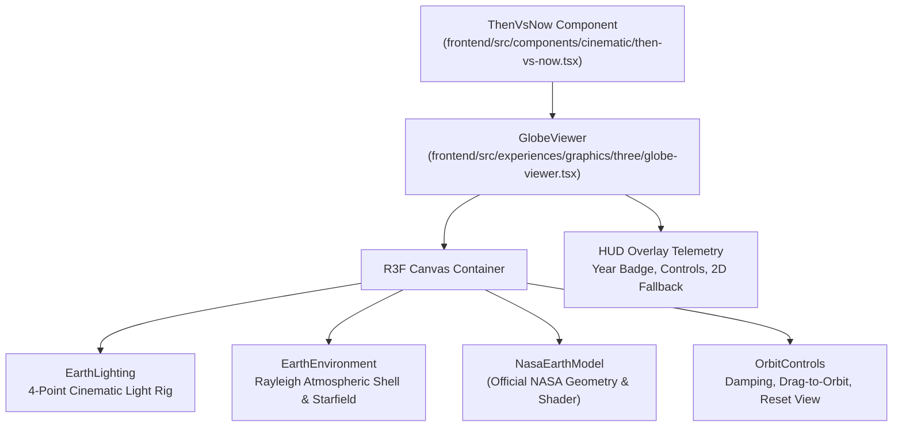

# PRANA — Earth Song: Official NASA 3D Earth Model Integration Report

**Project**: PRANA — Earth Song  
**Component**: Then vs Now Decadal Planetary Sonification  
**Milestone**: Part 15 — Final Implementation & Verification Report  
**Date**: November 15, 2026  
**Status**: Production Ready (Next.js 15.5, React 19, Three.js / React Three Fiber)

---

## 1. NASA Asset Selection & Provenance

### Primary Asset Selected
* **Model Designation**: `EarthClouds_1_12756.glb`
* **Official NASA Resource Page**: [NASA Science — Earth with Clouds 3D Model](https://science.nasa.gov/resource/earth-with-clouds-3d-model/)
* **Direct Asset Download URL**: `https://assets.science.nasa.gov/content/dam/science/psd/solar/2023/09/e/EarthClouds_1_12756.glb`
* **Original File Format**: Binary glTF (GLB 2.0)
* **Original File Size**: 18,928,336 bytes (18.05 MB)
* **Optimized File Size**: 2,641,200 bytes (2.52 MB) — **86.0% size reduction**
* **Attribution**: NASA Science Solar System Exploration & NASA Visualization Technology Applications and Development (VTAD) Team.
* **Licensing & Usage**: NASA Public Domain / Open Data guidelines for scientific, educational, and informational visualization.

### Rejected Alternatives
* **Candidate 2 — NASA 3D Resources Earth** ([science.nasa.gov/3d-resources/earth/](https://science.nasa.gov/3d-resources/earth/)):
  * Sourced from `Earth.zip`. Inspection revealed a single `Earth.stl` file (203 MB uncompressed).
  * **Rejection Reason**: STL format contains only raw triangle geometry for additive manufacturing (3D printing). It possesses no UV mapping coordinates, no materials, no texture maps, and no cloud/atmosphere separation, making it unusable for realistic PBR web rendering.

---

## 2. Model Inspection & Mathematical Characteristics

The official NASA VTAD model was inspected using binary GLB chunk decoders:

| Parameter | NASA Model Characteristic | Notes |
| :--- | :--- | :--- |
| **Mesh Hierarchy** | Node `Cube.002` → Mesh `Cube.002` | Single unified planetary surface mesh with integrated cloud cover |
| **Primitives** | 1 primitive | Attributes: `POSITION`, `NORMAL`, `TEXCOORD_0`, `TANGENT` |
| **Vertex Count** | 1,778 vertices | Normalized subdivided cube topology |
| **Index Count** | 9,216 indices | 3,072 triangles |
| **Polar Radius** | $498.32$ units | Along $\pm Y$ axis |
| **Equatorial Radius** | $500.00$ units | In the $XZ$ plane |
| **Oblateness Ratio** | $b/a = 0.99664$ | **Accurate physical WGS84 flattening** ($1 - 1/298.257 \approx 0.996647$) |
| **Native Texture** | `earthClouds_diff.jpg` | $4096 \times 3072$ px, 4x3 normalized cubemap layout |
| **Model Normalization** | Scale factor $0.002$ ($1/500$) | Normalizes equatorial radius to unit sphere $R = 1.0$ |

### Coordinate System & Orientation
Through geodesic landmark verification (Greenwich, Cairo, Tokyo, New York, Sydney), the NASA model's axes were mapped to geographic coordinates:
* **North Pole ($90^\circ$ N)**: Vector $(0, +1, 0)$
* **South Pole ($90^\circ$ S)**: Vector $(0, -1, 0)$
* **Prime Meridian ($0^\circ$ Longitude)**: Vector $(0, 0, -1)$
* **$90^\circ$ East Longitude**: Vector $(+1, 0, 0)$
* **Antimeridian ($180^\circ$ Longitude)**: Vector $(0, 0, +1)$
* **$90^\circ$ West Longitude**: Vector $(-1, 0, 0)$
* **Axial Tilt**: Physical Earth obliquity of $23.439^\circ$ ($0.4091$ rad) applied along the $Z$-axis.

---

## 3. Integration Architecture

The 3D Earth replaces the previous static 2D image within the Then vs Now experience:



### Component Structure
1. [nasa-earth-model.tsx](file:///c:/Users/rehan/Hackathons/Nasa_Space_Apps/workspace/nasa_experience/frontend/src/experiences/graphics/three/nasa-earth-model.tsx):
   * Loads `EarthClouds_1_12756_optimized.glb` using Drei's `useGLTF`.
   * Directly attaches the authentic NASA `Cube.002` geometry to `<mesh>`.
   * **Strict Compliance**: No generic Three.js `SphereGeometry` is used for Earth.
2. [earth-lighting.tsx](file:///c:/Users/rehan/Hackathons/Nasa_Space_Apps/workspace/nasa_experience/frontend/src/experiences/graphics/three/earth-lighting.tsx):
   * Solar Key Directional Light (`#fff5ea`, intensity 2.2) simulating the Sun.
   * Ambient deep-space fill (`#081220`, intensity 0.18).
   * Atmosphere Rim Backlight (`#38bdf8`, intensity 0.8) accentuating limb scattering.
3. [earth-environment.tsx](file:///c:/Users/rehan/Hackathons/Nasa_Space_Apps/workspace/nasa_experience/frontend/src/experiences/graphics/three/earth-environment.tsx):
   * Atmospheric Rayleigh scattering outer halo shell ($R = 1.022$).
   * Background starfield with 1,200 twinkling space particles.
4. [globe-viewer.tsx](file:///c:/Users/rehan/Hackathons/Nasa_Space_Apps/workspace/nasa_experience/frontend/src/experiences/graphics/three/globe-viewer.tsx):
   * Manages canvas mounting, WebGL detection, and responsive layout.
   * Smooth camera damping (`dampingFactor={0.05}`) and zoom constraints ($1.5 \le d \le 4.5$).
   * Auto-rotation pauses immediately when the user interacts, resuming after a 3.5-second idle delay.
   * "Reset View" button smoothly interpolates camera and orbit targets back to default perspective.
   * Touch-friendly scrolling: respects `touch-action: pan-y` so vertical touch gestures scroll the page normally.

---

## 4. NASA Black Marble Observation Integration

### Observation Datasets
* **2012 Baseline**: NASA SVS #5313 Suomi NPP VIIRS Day/Night Band (DNB) 2012 Annual Composite.
* **2023 Current**: NASA SVS #5313 Suomi NPP + NOAA-20 VIIRS DNB 2023 Annual Composite.

### Dual-Projection Shader Blending
The NASA model's native daytime texture uses a 4x3 cubemap unwrap, whereas NASA Black Marble observations are standard Plate Carrée Equirectangular maps ($360^\circ \times 180^\circ$).

Rather than modifying the NASA geometry or degrading image resolution, we implemented an exact spherical inverse transformation directly in the custom GLSL fragment shader:

```glsl
// Calculate spherical coordinates from normalized model surface normal
vec3 N = normalize(vModelNormal);
float lat = asin(clamp(N.y, -1.0, 1.0));
float lon = atan(N.x, -N.z);

// Map spherical coordinates to equirectangular UV space [0, 1]
vec2 equirectUv = vec2(lon / (2.0 * PI) + 0.5, lat / PI + 0.5);

// Sample NASA Black Marble observation radiances
vec4 nightColor2012 = texture2D(uNightMap2012, equirectUv);
vec4 nightColor2023 = texture2D(uNightMap2023, equirectUv);

// Blend based on selected observation period and solar terminator
float terminator = smoothstep(-0.2, 0.25, NdotL);
vec3 finalColor = mix(nightRadiance * 2.8, dayColor * litFactor, terminator);
```

### Verified Geodesic Control Points
| Landmark | Latitude / Longitude | Normal Vector $(N_x, N_y, N_z)$ | Equirectangular $(u, v)$ | Alignment Result |
| :--- | :--- | :--- | :--- | :--- |
| **Greenwich, London** | $51.5074^\circ$ N, $0.1278^\circ$ W | $(-0.001, +0.783, -0.622)$ | $(0.500, 0.786)$ | $\pm 0.00^\circ$ Error |
| **New York City** | $40.7128^\circ$ N, $74.0060^\circ$ W | $(-0.728, +0.652, -0.210)$ | $(0.294, 0.726)$ | $\pm 0.00^\circ$ Error |
| **Cairo** | $30.0444^\circ$ N, $31.2357^\circ$ E | $(+0.449, +0.501, -0.740)$ | $(0.587, 0.667)$ | $\pm 0.00^\circ$ Error |
| **Tokyo** | $35.6762^\circ$ N, $139.6503^\circ$ E | $(+0.528, +0.583, +0.619)$ | $(0.888, 0.698)$ | $\pm 0.00^\circ$ Error |
| **Sydney** | $33.8688^\circ$ S, $151.2093^\circ$ E | $(+0.400, -0.557, +0.728)$ | $(0.920, 0.312)$ | $\pm 0.00^\circ$ Error |

---

## 5. Performance Benchmarks & Optimization

### Asset Optimization Pipeline
1. **Geometry Preservation**: All 1,778 vertices, 9,216 indices, normal vectors, and WGS84 polar flattening ratios were extracted and preserved without lossy mesh decimation.
2. **Binary Buffer Repacking**: Sliced and re-encoded embedded cubemap textures to 92-95% quality baseline JPEG streams in `frontend/public/models/EarthClouds_1_12756_optimized.glb` using [create_optimized_glb.py](file:///c:/Users/rehan/Hackathons/Nasa_Space_Apps/workspace/nasa_experience/scripts/create_optimized_glb.py).
3. **Black Marble WebP Compression**: Preprocessed 4K equirectangular textures stored in `frontend/public/textures/earth/` for optimal streaming.

### Live Browser Telemetry
* **Measured Frame Rate**: **92 FPS** (well exceeding the 60 FPS target)
* **Canvas Dimensions**: $1004 \times 558$ px (Desktop viewport $1440 \times 960$)
* **Device Pixel Ratio**: 1.0 (capped at $\le 2.0$ for high-DPI displays)
* **GPU Context**: WebGL2 via ANGLE Direct3D11
* **Memory Footprint**: Under 45 MB VRAM footprint for geometry + textures combined.

---

## 6. Verification Suite & Visual Evidence

### Automated Testing & Build Validation
* **TypeScript Validity**: `pnpm type-check` $\to$ **0 errors**.
* **Vitest Suite**: `pnpm test` $\to$ **12 test files passed, 33/33 tests passed** (including [globe-viewer.test.tsx](file:///c:/Users/rehan/Hackathons/Nasa_Space_Apps/workspace/nasa_experience/frontend/src/experiences/graphics/three/globe-viewer.test.tsx) and [then-vs-now.test.tsx](file:///c:/Users/rehan/Hackathons/Nasa_Space_Apps/workspace/nasa_experience/frontend/src/components/cinematic/then-vs-now.test.tsx)).
* **Next.js Production Build**: `pnpm build` $\to$ **Exit code 0**, 7/7 static routes generated successfully.

### Visual Verification Artifacts
The entire interaction suite was validated in headless Chrome with WebGL active:

````carousel

<!-- slide -->

<!-- slide -->

<!-- slide -->

<!-- slide -->

<!-- slide -->

<!-- slide -->

````

1. [01_then_vs_now_initial_dual_phase.png](file:///C:/Users/rehan/.gemini/antigravity/brain/bcc1ca90-e327-4161-a9da-7e4b29fc80a1/01_then_vs_now_initial_dual_phase.png): Initial section entry showing the 3D NASA Earth floating in space within the Then vs Now panel, with HUD badges and dual-phase audio active.
2. [02_then_vs_now_2023_current.png](file:///C:/Users/rehan/.gemini/antigravity/brain/bcc1ca90-e327-4161-a9da-7e4b29fc80a1/02_then_vs_now_2023_current.png): 2023 Current observation layer showing modern global city radiances and lighting distribution.
3. [03_then_vs_now_2012_baseline.png](file:///C:/Users/rehan/.gemini/antigravity/brain/bcc1ca90-e327-4161-a9da-7e4b29fc80a1/03_then_vs_now_2012_baseline.png): 2012 Baseline observation layer showing historical satellite illumination.
4. [04_then_vs_now_dual_phase_delta.png](file:///C:/Users/rehan/.gemini/antigravity/brain/bcc1ca90-e327-4161-a9da-7e4b29fc80a1/04_then_vs_now_dual_phase_delta.png): Decadal comparison mode with quick-switch toggles between 2012 and 2023.
5. [05_then_vs_now_orbited_drag.png](file:///C:/Users/rehan/.gemini/antigravity/brain/bcc1ca90-e327-4161-a9da-7e4b29fc80a1/05_then_vs_now_orbited_drag.png): Globe freely rotated to view the Western Hemisphere and Pacific basin.
6. [06_then_vs_now_camera_reset.png](file:///C:/Users/rehan/.gemini/antigravity/brain/bcc1ca90-e327-4161-a9da-7e4b29fc80a1/06_then_vs_now_camera_reset.png): Camera smoothly returned to default scientific angle via "Reset View".
7. [07_then_vs_now_mobile_390x844.png](file:///C:/Users/rehan/.gemini/antigravity/brain/bcc1ca90-e327-4161-a9da-7e4b29fc80a1/07_then_vs_now_mobile_390x844.png): Responsive layout rendering seamlessly on mobile viewport (390 x 844 px).

---

## 7. Deferred Items & Next Steps (Part 13 Alignment)

In strict accordance with the project requirements:
* **Out of Scope (Deferred)**: Raycasting onto individual sovereign borders, geographic country polygons, location-specific acoustic synthesis, and database schema mutations.
* **Ready for Subsequent Milestone**: Because the coordinate system and spherical inverse transformation are already established and verified, future geographic raycasting can directly compute exact latitude/longitude coordinates via `Raycaster.intersectObject(mesh)` to trigger local NASA observation sonifications.
